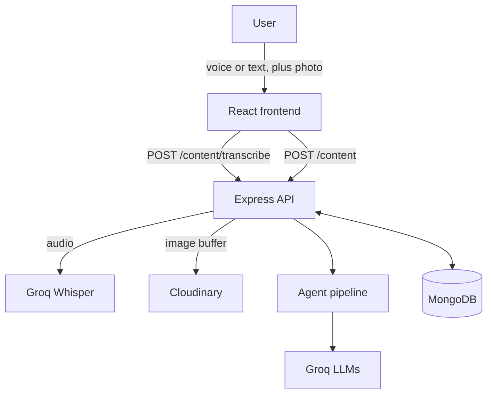

# LogToPost

**Turn a quick daily log (typed or spoken, with an optional photo) into ready-to-review posts for Instagram, LinkedIn and Twitter, written in your own voice.**

- Live app: [https://log-to-post-ai.lovable.app]
- Backend API: [https://logtopost.onrender.com]
- Demo video: [https://www.loom.com/share/4cdbb86a066e453882c93a39fcffdfcf]


> Note: the backend runs on a free hosting tier. The first request after a quiet period can take up to about a minute while the server wakes up.

---

## Problem Statement

Independent professionals such as interior designers do interesting work every day, but they rarely have time to turn it into polished social media content. Posting is inconsistent, each platform needs a different style and length, and generic AI tools tend to produce bland text that invents details the professional never said.

## Target Users

Independent professionals and small studios who want a steady social presence without spending hours writing. LogToPost was built for a practicing interior designer [FILL IN: adjust or remove this line], and is designed to work for any profession.

## Solution

The user logs their day in one or two sentences, by typing or by voice, and can attach a photo. LogToPost:

1. Transcribes the voice note (if used).
2. Reads the photo to extract real visual details.
3. Analyzes the log and drafts three differently toned posts for each platform.
4. Has a second "editor" step pick the strongest draft and refine it, without adding facts that were never provided.
5. Lets the user review, edit and approve each post. Approved posts are saved and used to make future drafts sound more like the user.

A human always approves before anything is used. The AI drafts, the professional decides.

## Key Features

- **Voice or text logs.** Record a short voice note and get an editable transcript (Groq Whisper).
- **Photo understanding.** A vision model describes the uploaded photo so posts use real details from it.
- **Multi-step AI pipeline.** Analyze, generate, critique and refine, with validation and retries at each step.
- **Platform-aware output.** Separate rules for Instagram, LinkedIn and Twitter (length, hashtags, tone, closing question).
- **Fact grounding.** Prompts forbid invented details, and the critique step removes any that slip through.
- **Review and approve workflow.** Each post has a status (pending or approved), an "Agent's Pick" with reasoning, and a copy button.
- **Personalization.** The user's most recent approved posts are fed back into the prompt as style examples.
- **History.** All logs, photos and generated posts are saved per user.

## Tech Stack

| Layer | Technology |
|---|---|
| Frontend | React (Vite), generated with Lovable [FILL IN: confirm TypeScript/Tailwind if you mention them] |
| Backend | Node.js, Express |
| Database | MongoDB with Mongoose |
| Authentication | [JWT + bcrypt, via an `isAuthenticated` middleware] |
| File uploads | Multer (memory storage), Cloudinary |
| Text LLM | Groq: `openai/gpt-oss-20b` |
| Vision LLM | Groq: `qwen/qwen3.8-27b` |
| Speech-to-text | Groq: `whisper-large-v3-turbo` |
| Hosting | Render (backend), [https://logtopost.onrender.com] (frontend), [https://log-to-post-ai.lovable.app]|

## Architecture



### The agent pipeline

```
photo URL(s) --> Step 0: Vision      describes only what is visible
text + photo description
             --> Step 1: Analyze     key moments, tone, audience, hook (JSON)
for each platform (Instagram, LinkedIn, Twitter):
             --> Step 2: Generate    3 drafts in different tones, using the
                                     user's approved posts as style examples
             --> Step 3: Critique    picks the best draft and improves it,
                                     with a rule against adding new facts
```

Design decisions:

- **Prompt chaining instead of one big prompt.** Each step has one job and returns structured JSON that the next step consumes, which makes each step easier to debug.
- **Validation and retries.** Every LLM response is parsed and checked for the expected shape. A failed step is retried once.
- **Graceful degradation.** If the vision step fails, the pipeline continues with text only. If the critique step fails for a platform, the first draft is returned instead of failing the whole request.
- **Sequential platform calls.** Calls run one platform at a time to stay within the LLM provider's rate limits.
- **Server-side uploads.** Images pass through the backend (Multer to Cloudinary), so no upload credentials are exposed to the browser.

### Data model

- **User**: [ fields, including `profession`, which personalizes the prompts]
- **Log**: `user`, `text`, `image`, timestamps
- **Content**: `user`, `log`, `platform`, `options[]` (text, tone, angle, reasoning), `refined` (bestOptionIndex, whyBest, weakness, refinedText), `approved` (final text or null), `status` (`pending` or `approved`)

### API endpoints

| Method | Path | Description |
|---|---|---|
| POST | `/content` | Create a post from `text` and optional `image` (multipart). Runs the pipeline and saves one Log and three Content documents. |
| POST | `/content/approve` | Approve a post: `{ contentId, approvedText }` |
| GET | `/content/history` | List the signed-in user's content, newest first, with its log |
| POST | `/content/transcribe` | Transcribe a voice note: multipart field `audio`, returns `{ text }` |

All `/content` routes require authentication. Auth routes: [signup and login paths].

## Error Handling and Reliability

- A log with no text and no image is rejected with a clear message.
- Audio uploads are limited to 10 MB. Empty or unintelligible audio returns a friendly error.
- LLM output is validated; invalid or empty responses are retried and then reported with a useful error.
- The vision and critique steps degrade gracefully instead of failing the request.
- Unauthorized requests are rejected by the auth middleware.
- The frontend shows loading, success and error states for generation and transcription.

## Local Setup

### Backend

```bash
git clone [https://github.com/ARMedAndCurious/LogToPost]
cd Server
npm install
cp .env.example .env     # then fill in your values
npm run dev              # or: node index.js
```

### Frontend

```bash
git clone [https://github.com/ARMedAndCurious/log-to-post-ai]
cd log-to-post-ai
npm i
npm run dev
```

Set the frontend's API base URL to your backend (for example `http://localhost:5000`) and make sure the backend allows the frontend's origin in its CORS settings.

## Environment Variables

Create a `.env` file in the backend folder. Never commit it.

| Variable | Purpose |
|---|---|
| `PORT` | Port the server listens on |
| `MONGODB_URI` | MongoDB connection string [FILL IN: match your variable name] |
| `JWT_SECRET` | Secret for signing tokens [FILL IN: match your variable name, or remove] |
| `GROQ_API_KEY` | Groq API key (text, vision and speech models) |
| `GROQ_VISION_MODEL` | Vision model ID, e.g. `qwen/qwen3.8-27b` |
| `CLOUDINARY_CLOUD_NAME` | Cloudinary cloud name |
| `CLOUDINARY_API_KEY` | Cloudinary API key (must allow uploads) |
| `CLOUDINARY_API_SECRET` | Cloudinary API secret |

## Deployment

- **Backend:** deployed on Render from this repository. Environment variables are set in the Render dashboard.
- **Frontend:** [https://log-to-post-ai.lovable.app].

## Known Limitations and Future Work

- One photo per post today. The pipeline and vision step already accept several images, so multi-image upload is mostly a route, model and UI change.
- Posts are copied manually. Direct publishing and scheduling are not built.
- Whisper can mishear mixed Hindi-English speech, so the transcript is always shown for editing before use.
- AI drafts can still occasionally blend or embellish details, which is why every post goes through human approval.

## AI Usage and Credits

- The frontend UI was generated with Lovable.
- The backend, data model, API and pipeline design are the author's work. AI tools (Claude and others) were used for brainstorming, debugging, code review and documentation, as allowed by the course guidelines. [FILL IN: adjust to describe your own contribution accurately]
- Models and APIs: Groq (LLM, vision, Whisper) and Cloudinary (image storage).

## Author

Akshara Jain, Scaler School of Technology
